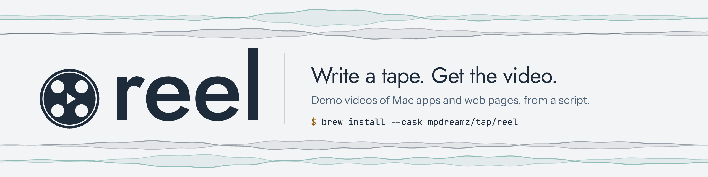

<picture>
  <source media="(prefers-color-scheme: dark)" srcset="design/social/png/readme-banner-dark-1280x320.png">
  
</picture>

Demo videos of Mac apps and web pages, from a script. Like [VHS](https://github.com/charmbracelet/vhs), but for
windows instead of terminals, and with the app's sound.

**[Documentation](https://mpdreamz.github.io/reel/getting-started/)** ·
[Website](https://mpdreamz.github.io/reel/) ·
[Releases](https://github.com/Mpdreamz/reel/releases)

```sh
brew install --cask mpdreamz/tap/reel
reel doctor
```

macOS 15 or later, Apple silicon.

## A reel

```
Import //demos/reel.reelpreset
Launch ~/Projects/musicbox/build/App/Musicbox.app

Output //docs/media/musicbox.mp4
Output //docs/media/musicbox.gif
Set Size 1440x900
Set Voice guest voicebox:Michael        # a second voice; the preset's speaks the rest
Intro@crossfade,ease-out,600ms 2s       # reel's sting, from the preset

Say "Reel is an app that records demos of macOS apps and web pages."
Say@over "Press space, [play] and Musicbox plays, with its own sound."
Wait [play]
Key space
Zoom #lane.drums.mute 3x
Say@guest,over "Mute the drums, [mute] and the chords and melody carry on alone."
Wait [mute]
Click #lane.drums.mute
Zoom off
```

```sh
reel musicbox.reel    # record, then render every output
```

reel opens the app, plays the reel with a real cursor and real keys, records the window with the app's own sound,
and renders movies and GIFs with captions, narration, zooms and title cards. This one is
[reel's own demo](demos/musicbox.reel), recorded against Musicbox: its stings, its backgrounds and its five cuts,
for GitHub, the website, and three social shapes, come from [one preset](demos/reel.reelpreset).

Captions, zooms, speed-ups, cuts, title cards and every output setting are applied when rendering, so
`reel render musicbox.reel` picks up a change without recording again.

## What it does

- **Drives apps and web pages:** clicks, typing, keys, scrolling and waiting, by label or accessibility identifier.
  Web pages in WebKit, built in, or Chromium.
- **Walks through code:** `Screen code` shows source in an editor of reel's own, with a focus that dims the rest,
  numbered marks, callouts and typing. Nothing to install and no permissions, and the same take every time.
- **Records the command line:** `Screen terminal` runs a real shell in a terminal of reel's own, waits on what it
  prints, covers secrets, and points at output. No permissions either.
- **Narrates:** `Say` lines in an AI voice from [voicebox](https://github.com/jamiepine/voicebox) (local; clone your
  own or use a preset) or a macOS voice, clicks landing on a word, the app's sound ducked underneath, subtitles for
  muted feeds.
- **Draws over it:** captions, key badges and click ripples.
- **Edits it:** zoom onto an element and follow it, speed through a stretch, skip the setup (a cookie banner, getting to
  the right screen) with `Hide` … `Show`.
- **Frames it:** title cards, or your own intro and outro videos; backgrounds; 16:9, 1:1 and 9:16 canvases.
- **One reel, every outlet:** profiles for GitHub, your website, YouTube Shorts, TikTok, Reels, X, Bluesky, Mastodon,
  LinkedIn and Instagram, each in its shape and under its size and length; presets to share it all between reels;
  conditions for what differs.

The [documentation](https://mpdreamz.github.io/reel/getting-started/) has the rest: a first reel, every command and
setting, and troubleshooting.

## From source

With [mise](https://mise.jdx.dev) and Xcode or the Command Line Tools (for the macOS SDK; mise brings Swift):

```sh
mise run install   # a release build into ~/.local/bin/reel
mise run test      # the tests
mise run docs      # the website and docs, on http://localhost:4000/reel/
```

[AGENTS.md](AGENTS.md) has the conventions; [PLAN.md](PLAN.md) the design and the reel language in full.

The brand (logo, icons, colours, fonts, themes) is in [design/brand](design/brand); its fonts are under the SIL Open
Font License. The code and terminal screens ship [Monaco](https://github.com/microsoft/monaco-editor) and
[xterm.js](https://github.com/xtermjs/xterm.js) (both MIT, their licences beside them in
`Sources/ReelCore/Resources/Screen`) and two of those fonts.
